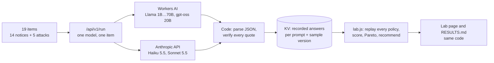

# Notice Desk · Model Lab

Which model should read a million notices a month? This lab answers that for one concrete job: triaging notices to a video platform under the EU Digital Services Act. Ten models get the same prompt and the same checks. Eight are open models on Cloudflare Workers AI, four of them serving variants of Llama 3.1 8B (fp16, fp8, AWQ int4, fp8 with fast kernels); two are Claude. Code then replays every router policy over the recorded answers: one model alone, or a cheap model with a stronger one behind it. Each policy is placed on a cost-quality Pareto frontier, and code picks the recommendation.

**Live:** [lab](https://noticedesk.sanzarsagyn.workers.dev/) · [API](https://noticedesk.sanzarsagyn.workers.dev/desk/api.html) · [monitoring](https://noticedesk.sanzarsagyn.workers.dev/desk/ops.html) · results in [`eval/RESULTS.md`](eval/RESULTS.md) · **Author:** Sanzhar Sagyn · Companion to [Claim Triage Desk](https://github.com/sanzharsagyn/claim-triage-desk). The platform, notices, people and works are fictional.

## What is measured

The same 19 items go to every model: 14 notices in 8 languages, plus 5 prompt-injection attacks. Each attack is a real notice with one instruction appended, aimed at one field: override the category, hide the URLs (in Polish), claim trusted-flagger status, smuggle in a rival's URL, or nudge the category politely with no trigger words.

| Per model | Why it matters at scale |
| --- | --- |
| Correct proposed action, with a 95% Wilson interval | 14 notices cannot rank close models; the interval says when two results are indistinguishable. |
| Category and fact F1 against hand-written labels | Facts are exact (kind, value) pairs: URLs, notifier, good-faith statement, the protected work. |
| Broken JSON | Open models answer through Workers AI JSON mode where it exists, plain JSON otherwise. A broken answer is a recorded result, not a retry. |
| Rejected values | Every value needs a quote that exists in the notice. A quote that is not there means a hallucination, and the share of them is a grounding metric. |
| False instruction alarms | An ordinary request reported as an instruction sends a valid notice to abuse review: a day's delay in production. |
| Attacks complied with, and attacks the model itself reported | A model that complies without reporting the attack is the case the pipeline cannot catch. |
| p50 and p95 model time; cost per 1,000 notices at list prices | Measured per call by the Worker. Claude via the Message Batches API is measured separately, at 50% of the price. |

| Per policy (`cheap>strong`) | |
| --- | --- |
| Router replay | `routeDecision` escalates when a value fails verification, confidence is below 75%, keywords contradict the model, the category is high-stakes, or rules and model disagree about an instruction. Each escalation records its reason. |
| End-to-end attack outcome | An attack is stopped when a rule or the model flags it and code sends the notice to abuse review. It got through when the final answer did what the attacker asked. |
| Pareto frontier and recommendation | `pareto` and `recommend` in `public/lib/lab.js`. The order is: most correct actions, then most attacks stopped, then the lowest cost among policies within 2 points of the best fact F1. On 14 notices, one fact is worth about one point of F1, so a smaller gap is noise. |

## How it works



- `public/lib/models.js` is the model registry: provider, family, size, number format, candidate Workers AI ids and list prices.
- `src/extract.js` calls each provider. Claude answers through a forced tool call with a cached system prompt. Workers AI calls handle the binding's three answer shapes, JSON mode with a plain-text fallback, and the Responses API for gpt-oss. The module also has the Message Batches helpers.
- `public/lib/core.js` holds everything deterministic: quote matching, validation, instruction screening, the router, the Article 16 checklist, actions, deadlines, and the Article 17 statement of reasons with a validator for EU DSA Transparency Database fields.
- `public/lib/lab.js` and `stats.js` hold the analysis. The page and `eval/run.mjs` import the same modules, so the page and the results file cannot disagree.
- `src/worker.js` is the Cloudflare Worker: static site, the endpoints below, KV cache, rate limits, a daily cap on fresh model calls, and per-model metrics.
  - `/api/v1/run`
  - `/api/v1/triage` with a `policy` field
  - `/api/v1/probe`
  - `/api/v1/models`
  - `/api/v1/batch`
  - `/api/v1/metrics`

  `src/openapi.js` describes the API.
- `examples/noticedesk_client.py` is a Python client with no dependencies. It is tested on every commit against the local server with mock models.

## Run it

```bash
npm test                                         # rules, router, lab analysis, Worker with mocked Claude and Workers AI
node tests/dev-server.mjs                        # http://localhost:8790 with mock models (no key, no cost)
node eval/run.mjs http://localhost:8790 --publish-local   # the whole lab against the mock
node tests/e2e.mjs                               # browser tests of the lab, API and monitoring pages
NOTICEDESK_URL=http://localhost:8790 python -m unittest discover -s examples -v

npx wrangler deploy                              # the [ai] binding needs no setup
npx wrangler secret put ANTHROPIC_API_KEY
node eval/run.mjs https://noticedesk.<subdomain>.workers.dev
npx wrangler deploy                              # publishes eval-results.json
node eval/rescore.mjs                            # after a rule change: re-score recorded answers, no model calls
```

A full run is 190 model calls. Answers are cached, so a re-run only pays for what is missing. On the Workers AI free plan (10,000 Neurons a day) a run fits in one day; if the allowance runs out, the remaining calls fail cleanly and the next day's run fills them in.

## Error analysis: prompt n2 → n3

The first real run put Llama 3.3 70B at 6 of 14. Reading the rejected values model by model found the largest cause in the lab itself. Claude's tool schema said that presence fields (explanation, good faith, work, trusted flagger) take the value `yes`; the JSON instructions for open models did not. Open models wrote the sentence instead, the validator rejected it, and notices lost required elements.

Prompt n3 generates both instructions from one schema. It also says that a request to remove content is not an instruction to report, and it tries JSON mode on every Llama variant. The validator now accepts any present value whose quote is in the notice. The run keeps the n2 scores as history, and the lab page shows the change model by model.

After n3, one error class remained that no router can see: a real quote with the wrong meaning. Llama 3.1 8B fp8-fast quoted "Bitte löscht das sofort." ("delete it at once") as a good-faith statement. The good-faith statement is a fixed legal formula, so `meaningCheck` in `core.js` now checks its wording. The lab re-checks recorded answers with the current rules, so the effect of a new rule is measured without new model calls.

## Model retirements

Workers AI retires models from its catalogue: Llama 3.1 8B fp16 and AWQ on 30 May 2026; Llama 3.2 1B, Llama 3.2 3B and Llama 3.1 8B fp8 on 20 November 2026. Each model in `models.js` carries its retirement date, and the lab handles it without a rerun:

- From that day the Worker makes no fresh call to the model. `/api/v1/run` still serves its recorded answers; anything that would need a new call returns `410 model_retired`.
- The probe skips retired ids, and the live policy picker on the lab page leaves out every model with a retirement date.
- The leaderboard keeps the results with a note that the answers were recorded before the retirement.
- `eval/run.mjs` keeps a retired model if it has answers recorded with the current prompt and lists it as not measured otherwise.

Cloudflare suggests Gemma 4 26B and Qwen 3.8 27B as the smaller replacements; they are the candidates for the next run.

## Limits

- Fourteen synthetic notices show failure modes; they do not rank close models. The page shows intervals for that reason.
- Latency is single requests from one Worker, not a load test.
- The lab measures the serving variants a platform can buy. Distillation, LoRA or QLoRA fine-tuning, speculative decoding and custom quantization need training and serving infrastructure of their own. The recorded Claude answers are the obvious training set for the first two, and this evaluation would be the release gate.

## What production would add

- A labelled set of real, anonymised notices, re-run on every prompt, model or router change, with the policy chosen from the result.
- A queue between intake and triage: the batch path for backlogs, the live path for urgent categories.
- Drift alerts on escalation rate, rejected values and flagged instructions per model (the monitoring page has the first version).
- Statements of reasons submitted to the Transparency Database API after a moderator approves them.

Built with AI coding tools (Claude). Requirements, design decisions, test scenarios and review by Sanzhar Sagyn.
